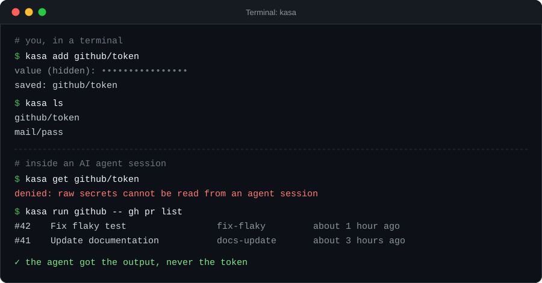
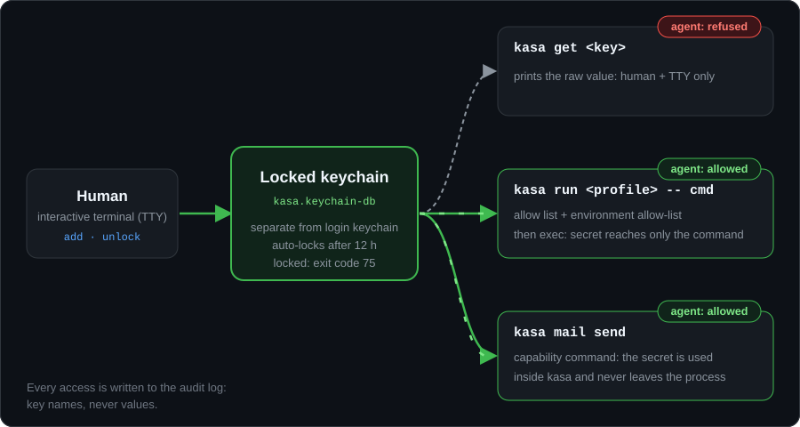

**English** · [Türkçe](README.tr.md)

<p align="center">
  
</p>

<p align="center">
  <b>kasa keeps your secrets in a separate, lockable macOS keychain and lets AI coding agents run commands that use them, without the agent ever seeing the value.</b>
</p>

<p align="center">
  
  
  
  
</p>

> [!CAUTION]
> **IMPORTANT: protect your signing certificate.**
> The person who installs kasa creates a self-signed code-signing certificate (`make cert`). The vault's items trust that certificate and, through the macOS partition list, the kasa build that wrote them: an upgrade hands them over (`make install DEVIR_YEDEK=`, see [Signing certificate and migration](#signing-certificate-and-migration)). If you lose it, kasa can no longer read the vault, and nothing can read it for you: there is no master-password repair. Keep the encrypted `.p12` backup somewhere safe, off this machine too, and never share it: whoever holds it can pass as kasa. Recovery paths are under [Lost certificate](#lost-certificate).

## Why

When you work with an AI coding agent (Claude Code, Codex, Cursor, Gemini CLI, ...), pasting a token into the chat writes it into the transcript permanently. It then lives in logs, history files and possibly provider-side storage, long after you have forgotten it.

`kasa` fixes the workflow instead of the symptom: you store a secret once, from a real terminal, and from then on the agent runs `kasa run github -- gh pr list`. The secret is injected into that one allow-listed process as an environment variable. It never appears in the conversation, in the agent's context, in a file, or in any process's arguments.

## Quick start

Requires macOS and Go (cgo enabled, which is the default).

```bash
git clone https://github.com/eirikaleid/kasa.git
cd kasa
make cert-hazir              # signing certificate: ready -> nothing; else restores ~/kasa-signing-cert.p12; else creates a new one (read the box above)
make install                 # builds, signs with that certificate, installs to ~/.local/bin/kasa

kasa init                    # once: choose a master password (only you know it)
kasa add github/token        # value is prompted, hidden, never echoed
kasa profile edit            # define which secrets go to which commands
kasa run github -- gh pr list
```

**On a new machine** (also from a non-interactive setup script) run `make cert-hazir && make install`. `make cert-hazir` is idempotent: if `local.mk` names a `SIGN_IDENTITY` that is in the keychain it does nothing; otherwise, if the `.p12` backup exists (`CERT_P12=<file>`, default `~/kasa-signing-cert.p12`), it imports it and writes its SHA-1 to `local.mk`: the restored certificate has the SHA-1 it always had, so a byte-identical build of the same source reads the vault's existing items (any other build needs the handover). Only when there is no backup does it create a **new** certificate (the `make cert` path), which cannot read items of an existing vault (`kasa import` needed). The `.p12` passphrase is taken from `KASA_CERT_P12_PASSPHRASE` or read hidden from `/dev/tty`; with neither, the script stops with an error. It never goes on a command line. `KEYCHAIN=<file>` targets another keychain.

`make cert` writes `SIGN_IDENTITY` to `local.mk` and refuses to run again while `local.mk` names a certificate. Without a certificate `make build` fails instead of signing ad-hoc (an ad-hoc kasa would lose the vault on its next rebuild). `make build ADHOC=1` does it deliberately, with a warning.

**Upgrading from before 2.5.0:** items written by older versions trust `/usr/bin/security`, so any process of yours could read them. After `make cert` and `make install`, move them (human only, see [Migrating](#migrating-from-before-250) for the full sequence):

```bash
kasa acl migrate --dry-run   # report only
kasa acl migrate             # encrypted backup first, then item by item
```

Make sure `~/.local/bin` is on your `PATH`. A minimal `~/.config/kasa/profiles.json` for the example above:

```json
{
  "profiles": {
    "github": {
      "aciklama": "GitHub CLI",
      "secrets": { "GITHUB_TOKEN": "github/token" },
      "allow": ["gh"]
    }
  }
}
```

### Shell integration (optional)

`kasa which` takes its values only from a hidden prompt and rejects any value given as an argument, so nothing secret reaches your shell history or `ps` whether or not you install this. The integration is an extra layer: it keeps even the rejected `kasa which ...` / `kasa lookup ...` lines out of your shell history. To add it, put one line in your shell rc file:

| Shell | Line to add | File |
|---|---|---|
| zsh | `eval "$(kasa shell-init zsh)"` | `~/.zshrc` |
| bash | `eval "$(kasa shell-init bash)"` | `~/.bashrc` |
| fish | `kasa shell-init fish \| source` | `~/.config/fish/config.fish` |
| PowerShell (`pwsh`) | `kasa shell-init pwsh \| Out-String \| Invoke-Expression` | `$PROFILE` |

`kasa shell-init <shell>` only prints shell code; it does not touch the keychain. The code skips history for lines starting with `kasa which` or `kasa lookup` (leading space included), chains with any history hook you already have instead of replacing it, and sets `KASA_HISTORY_GUARD=1`. To check it, open a new shell and run `echo $KASA_HISTORY_GUARD`; it prints `1`. kasa itself is macOS-only; the `pwsh` variant is for PowerShell on macOS and for a possible Windows port later. Fish needs a version that calls `fish_should_add_to_history`; on older versions the line is still saved.

<p align="center">
  
</p>

## How it works

<p align="center">
  
</p>

Secrets live in a dedicated keychain (`~/Library/Keychains/kasa.keychain-db`), not in your login keychain. It auto-locks after 12 hours of inactivity; while it is locked nobody can read anything. Agents can use secrets in two ways, and neither reveals the value:

1. **`kasa run <profile> -- <cmd>`** resolves `<cmd>` to a full path, checks it against the profile's `allow` list, builds a minimal environment (see [Profiles](#profiles)) and runs the command with the secrets added. Free-form commands are refused. If stdout and stderr are both terminals the command replaces kasa (`exec`); otherwise it still replaces kasa (same PID, so `alarm`, `kill -9` and the exit status reach it directly), and a masking side process replaces every secret value (6 bytes or more) in the non-terminal output with `***`. Output redirected straight to a file can finish a moment after the command exits. This catches accidental leaks only, not deliberate ones (base64, character by character).
2. **Capability commands** such as `kasa mail send` use the secret inside the `kasa` process and never hand it out.

`kasa get`, `kasa rm`, `kasa unlock` and `kasa import` are for humans: they refuse to run inside a detected agent environment or without a TTY. Every access is written to `~/.local/state/kasa/audit.log` (key names, never values).

If the keychain is locked, `kasa` exits with status `75` (`EX_TEMPFAIL`) instead of popping up a dialog, so agents and scheduled jobs fail cleanly. A human in a terminal gets the macOS password dialog; `KASA_SOR=1` opts in explicitly.

## AI agent integration

The agent-side guard is a best-effort speed bump. The real boundaries are the separate locked keychain and **your agent's own permission rules**. Configure both.

**Claude Code** (`~/.claude/settings.json` or project `.claude/settings.json`):

```json
{
  "permissions": {
    "allow": [
      "Bash(kasa run:*)",
      "Bash(kasa ls)",
      "Bash(kasa status)"
    ],
    "deny": [
      "Bash(kasa get:*)",
      "Bash(kasa rm:*)",
      "Bash(kasa which:*)",
      "Bash(kasa lookup:*)",
      "Bash(kasa unlock:*)",
      "Bash(kasa import:*)",
      "Bash(security find-generic-password:*)"
    ]
  }
}
```

**Codex, Cursor, Gemini CLI and others:** put the rules from [`AGENTS.md`](AGENTS.md) in the agent's instruction file and use the tool's own command allow/deny mechanism for the same patterns.

Ready-made files:

- [`AGENTS.md`](AGENTS.md): short rule set for agents that use kasa.
- [`skills/kasa/SKILL.md`](skills/kasa/SKILL.md): a Claude Code skill (copy it to `~/.claude/skills/kasa/`).
- [`llms.txt`](llms.txt): machine-readable project summary.
- [`docs/agents.md`](docs/agents.md): detailed setup for Claude Code, Codex and Cursor.

The one rule for agents: never ask the user to paste a secret, never call `kasa get`, use `kasa run`. If `kasa` exits with `75`, it is locked: ask the human to run `kasa unlock`.

## Commands

| Command | Description | Who |
|---|---|---|
| `kasa init` | Create the keychain (once) | human |
| `kasa unlock` / `kasa lock` / `kasa status` | Unlock, lock, show state and caller | unlock: human |
| `kasa unlock --gui` | Unlock through the macOS password dialog | human |
| `kasa morning` | Ask for the password via dialog if not unlocked today (for [launchd](contrib/launchd/README.md)) | scheduler |
| `kasa add <ns/key>` | Add a secret (hidden prompt) | human |
| `kasa add <ns/key> --stdin` | Read the value from stdin (for pipes) | human |
| `kasa ls` | List key names (no values) | anyone |
| `kasa get <ns/key>` | Print the raw value | human + TTY only |
| `kasa rm <ns/key>` | Delete a secret | human + TTY only |
| `kasa which [flags]` | Find which key holds a value (values come from a hidden prompt); prints key names only (see [below](#finding-a-key-from-a-value)) | human + TTY only |
| `kasa shell-init <zsh\|bash\|fish\|pwsh>` | Print shell code that keeps `kasa which` out of shell history (optional, see [Shell integration](#shell-integration-optional)) | anyone |
| `kasa run <profile> -- <cmd> [args]` | Run an allow-listed command with the profile's secrets as env vars | anyone |
| `kasa mail send --profile <p> --to <addr> --subject <s> [--body <m> \| --body-file <f>]` | Send mail via the profile's SMTP settings | anyone |
| `kasa profile ls \| edit \| path` | Show, edit or locate the profile file | anyone |
| `kasa profile test <profile> -- <cmd> [args]` | Dry run: would `run` allow this command line? Runs nothing, reads no secret, works while locked | anyone |
| `kasa audit [-n 30]` | Show the access log | anyone |
| `kasa target add\|rm\|ls [dir]` | Manage backup targets | human |
| `kasa export` | Write an encrypted backup to every target | needs backup password |
| `kasa export --target <dir>` | One-off target (see agent note under [Backups](#backups)) | needs backup password |
| `kasa backup ls` | Show backups per target and how old they are | anyone |
| `kasa backup-password status\|set\|rm` | Manage the stored backup password | set/rm: human |
| `kasa import <file.age> [--overwrite]` | Restore a backup on this machine | human + TTY only |
| `kasa acl migrate [--dry-run] [--target <dir>]` | Move items written before 2.5.0 to kasa's own ACL (takes an encrypted backup first, restore-checked) | human only |
| `kasa acl devral <backup.age>` | Upgrade handover: rewrite every item from the old kasa's encrypted export so this build can read it (`make install DEVIR_YEDEK=` runs it) | human only |
| `kasa version` | Print the version | anyone |

Keys have the form `<namespace>/<name>`, for example `github/token` or `mail/pass`. The old Turkish command names (`hedef`, `yedek`, `yedek-parola`, `sabah`, `--pencere`) are still accepted as hidden aliases.

## Finding a key from a value

`kasa which` (alias `lookup`) tells you which key(s) hold a value you already have, so you can give an AI agent only the key name. The values are compared inside the `kasa` process and never printed; the output is only the matching key names, one per line, sorted. Human + TTY only.

```bash
kasa which                    # exact match (case-sensitive, constant-time compare)
kasa which -i --contains      # contains, ignoring case
kasa which --all --contains   # asks for two values: BOTH must appear
kasa which -e                 # each value is a regular expression (Go RE2), matched anywhere in the value
```

Values are never arguments. `kasa which` asks for them on a hidden prompt (no echo): `Value 1 (empty line to finish): `, `Value 2 (...)`, and so on; an empty line ends the list. With several values, any one may match (`--all`: every one must). An argument that is not a flag, `--`, or an unknown flag is rejected with an error that does not repeat what you typed.

| Flag | Meaning |
|---|---|
| `-i`, `--ignore-case` | Case-insensitive (Turkish İ/I/ı are folded) |
| `--prefix`, `--suffix`, `--contains` | Partial match instead of exact match |
| `-e`, `--regex` | Each value is a Go regexp (RE2) pattern, matched anywhere in the secret; cannot be combined with `--prefix`/`--suffix`/`--contains`. With `-i`, literal text is folded and `(?i)` is added; escapes such as `\D` or `\p{Greek}` are kept as they are |
| `--all` | With several values, all of them must match (default: any one) |

Output goes to stdout. If nothing matches, stdout is empty, `no match` goes to stderr and the exit status is 1. Keys that cannot be read are listed on stderr as `unreadable: <name>`. The audit log records only the mode and counts, never a value or pattern.

> **Why:** a value on the command line would land in your shell history, in `ps` output and in AI chat transcripts. So the binary only accepts values from the hidden prompt. If you typed a value as an argument anyway, the line you typed may already be in your shell history; the error says so. An invalid `--regex` pattern is reported as `invalid regex (pattern not shown)`.

## Profiles

A profile maps environment variable names to key names and lists the commands allowed to receive them. Profiles hold references, never secrets. User profiles live in `~/.config/kasa/profiles.json`:

```json
{
  "profiles": {
    "github": {
      "aciklama": "GitHub CLI",
      "secrets": { "GITHUB_TOKEN": "github/token" },
      "allow": ["gh", "git"]
    },
    "mail": {
      "secrets": { "SMTP_USER": "mail/user", "SMTP_PASS": "mail/pass" },
      "allow": [],
      "smtp": { "host": "smtp.example.com", "port": 587, "from": "me@example.com" }
    }
  }
}
```

`aciklama` is an optional description. `smtp` is only needed for `kasa mail send`, which expects the secrets `SMTP_USER` and `SMTP_PASS`.

**Allow list.** The command is resolved to an absolute path and that path is what gets executed.

- A bare name (`"gh"`) matches only when the binary sits in a trusted directory (system directories, `/opt/homebrew`, `~/.local/bin`, pipx venvs, plus anything you bake in with [`TRUSTED_DIRS` / `DEV_ROOT`](#build-options)) and, for symlinks, the target is trusted too.
- An absolute entry (`"/usr/local/bin/deploy"`, `"~/bin/deploy"`) must match the resolved path exactly.
- **Pinned arguments.** An entry with spaces is split into tokens: the first is the command (a bare name or an absolute path, as above), the rest pin the first arguments. A bare `"python3"` lets an agent run `python3 -c 'print(os.environ)'` and read every secret in the profile; pinning prevents that. Arguments after the pinned prefix are free (the script's own arguments).
  - `"python3 ~/projects/x/"` (path ending in `/`): the first argument must be a regular file below that directory, after symlinks are resolved. It may not start with `-`, and `../` or a symlink pointing outside is refused.
  - `"python3 ~/projects/x/run.py"` (path without `/`): the first argument must resolve to exactly that file.
  - `"python3 -m trend_radar.bildir"` (anything else): plain text, must be equal.

  `python3 -c`, `node -e` or `sh -c` do not match any of these, so they are refused. Entries without spaces behave as before. A locked profile needs an absolute, clean command and absolute, clean path tokens (plain-text tokens such as `-m` are accepted, but `-m module` and bare file names resolve against the working directory the agent controls, so only an absolute path to a root-owned script is a real boundary, even in a locked profile). If the pinned directory or script is writable by you, an agent can edit the script: pinning is a speed bump, not a boundary (see [SECURITY.md](SECURITY.md)). A `-m` pin needs the module to be installed in the interpreter's own site-packages: for such entries kasa sets `PYTHONSAFEPATH=1` in the child so the working directory is not put on `sys.path`. Python before 3.11 ignores it and still adds the working directory, so `-m` is not protected there. `kasa profile test <profile> -- <cmd> [args]` shows which entry matches, or why none does. `kasa audit` logs the matching entry next to the command name, never the arguments.

  **Warning for risky entries.** In an unlocked profile, an entry whose command is an interpreter, shell, package runner or similar (`python`, `node`, `bun`, `sh`, `bash`, `perl`, `ruby`, `uv`, `npx`, `npm`, `pnpm`, `yarn`, `java`, `env`, `xargs`, `awk`, `find`, `curl`, ... or `"*"`; a version suffix such as `python3.13` is ignored) and that pins no path (`/...` or `~/...`) and no plain `-m` can print the profile's secrets. kasa warns about it: `kasa profile ls` prints a `warning:` line for the profile, and `kasa run` and `kasa profile test` print one line when the matching entry is risky; all of it goes to stderr (stdout is untouched, the command still runs). `kasa run` also writes `NOTE run <profile> risky allow entry: <entry>` to the audit log. Locked profiles are not checked (they only accept absolute paths). There is no setting to silence the warning.

**Environment.** The child process never inherits your full environment. It gets a fixed `PATH`, the profile's secrets, and an allow-list of variables (default: `HOME USER LOGNAME SHELL TMPDIR TERM COLORTERM NO_COLOR TZ LANG LC_* SSH_AUTH_SOCK`). Override it per profile with `"ortam": ["LANG", "LC_*", "MY_VAR"]`; `"ortam": []` means only `PATH` and secrets. Injection variables (`DYLD_*`, `LD_*`, `BASH_ENV`, `GIT_*`, `NODE_*`, `PYTHON*`, proxy and CA variables, ...) are always dropped, and the drop is logged as a `NOTE` with the variable name only.

**Locked profiles.** The user profile file is writable by you, and therefore by an agent running as you. For high-value secrets, put the profile in the root-owned `/usr/local/etc/kasa/profiles.json`. The file and all its parent directories must be root-owned and not group/world-writable, otherwise kasa refuses to run. Locked profiles override user profiles of the same name, can only be changed with `sudo`, should list absolute paths in `allow`, and their keys cannot be used by any other profile.

> Unlocked profiles are a convenience, not a security boundary. An agent that can edit `profiles.json` can, for example, point the `smtp` host at another server and have `kasa mail send` deliver the password there. Use locked profiles for anything valuable.

## Backups

The keychain file is macOS-specific and is never copied anywhere. The portable format is the file written by `kasa export`: an [age](https://age-encryption.org) file, passphrase-encrypted (scrypt) with ASCII armor. It contains the secrets and the profiles.

```bash
kasa target add /Volumes/Backup/kasa      # a target is just a directory
kasa target add ~/private-repo/backups
kasa target ls
# Since 2.4.0 targets live only in the root-owned /usr/local/etc/kasa/profiles.json
# ("hedefler"). `target add|rm` is human-only; it cannot write that file as you,
# so it prints the exact `sudo /usr/bin/plutil ...` command to run. Targets left
# in ~/.config/kasa/profiles.json are ignored, with a warning that prints the
# migration command.

kasa unlock
kasa export                               # same encrypted blob to every target
kasa backup ls                            # what is where, how old (stale after 30 days)
```

A target can be an external disk, a NAS mount, a cloud-sync folder or a directory in a private git repository. `export` encrypts once, verifies its own output by decrypting it, writes the same blob to each target atomically, reads each file back and compares it byte for byte. If any target fails, the command exits non-zero.

**Backup password.** `kasa backup-password set` stores the password in the kasa keychain under a separate service, so unattended exports work (for example from [launchd](contrib/launchd/README.md)). New passwords must be at least 12 characters and use all four character classes (upper, lower, digit, punctuation). Setting and removing the password is human-only, so an agent cannot plant a password it knows. Enter the password that opens your existing backups; changing it only affects new files.

**Agent note.** In an agent environment `export` writes only to the targets in the root-owned locked file (an agent cannot add one), not to arbitrary paths, and works only if the backup password is already stored.

**Restore** on a new machine, in this order:

```bash
kasa init
kasa unlock
kasa import kasa-backup-YYYYMMDD.age        # prompts for the backup password
```

`import` never overwrites existing keys unless you pass `--overwrite`. It is human + TTY only.

**Without kasa.** Any machine with `age` can open a backup. This is your insurance:

```bash
age -d kasa-backup-YYYYMMDD.age > contents.json
```

Keep at least two targets, and keep one of them off the machine. If a backup lives in a git repository, the repository must be private and the password long: anyone with the file can try to crack it offline.

## Signing certificate and migration

Items are written with an access list whose only trusted application is kasa itself. The entry stores kasa's designated requirement, `identifier "kasa" and certificate leaf = H"<sha1>"`: `/usr/bin/security`, an ad-hoc copy or any other process of yours gets `errSecAuthFailed` (interaction is disabled, so no dialog opens either).

**A rebuild does not read the vault by itself.** The vault lives in `~/Library/Keychains/`, where macOS also gives every item a partition list. kasa has no Team ID, so that list names the cdhash of the kasa that wrote the item: a build from changed source, even signed with the same certificate, gets `errSecAuthFailed` (a byte-identical rebuild of the same source still reads). The public API cannot widen a partition list, so an upgrade hands the items over (2.6.0): the installed kasa writes its encrypted backup, the new build deletes and rewrites every item from it, the backup-password item last. `make install` refuses to replace a different installed kasa without it and leaves the old one in place:

```bash
~/.local/bin/kasa unlock
~/.local/bin/kasa export ~/kasa-devir.age      # the OLD kasa writes its encrypted backup
make install DEVIR_YEDEK=~/kasa-devir.age     # asks the backup password, moves every item, then installs
```

If it stops halfway nothing is lost: the encrypted file stays, and running `kasa acl devral <file>` again skips the items already moved. With no vault or no items to keep: `make install DEVIR_ATLA=1`.

### Migrating from before 2.5.0

Do this in your own terminal, in this order:

```bash
kasa target ls                      # a backup target must exist (kasa target add <dir>)
kasa export                         # your usual encrypted backup, as an extra safety net
make cert && make install           # certificate, signed build
kasa unlock
kasa acl migrate --dry-run          # lists every item: would move / skipped / ERROR
kasa acl migrate                    # writes the encrypted backup, restore-checks it in a
                                    # temporary keychain, then moves item by item
kasa acl migrate                    # again: every item reports "skipped" (idempotent)
kasa ls && kasa run <profile> -- <cmd>
```

The old items are read the old way (`security find-generic-password -g`, the only reader their ACL trusts), deleted, and written again with the same label, kind, comment, service and account and kasa's own ACL. Each item is read back with kasa and compared byte for byte; on a mismatch the value held in memory is written again at once and the run stops. The `kasa-yedek-parola` item moves last. Nothing is edited in place and no private API is used. If the backup cannot be written or restored, nothing is changed.

### Lost certificate

1. **You still have the `.p12`.** Run `make cert-hazir && make install` (it imports the `.p12`, asks for its passphrase and writes the SHA-1 to `local.mk`; or import it yourself with `security import kasa-signing-cert.p12 -k ~/Library/Keychains/login.keychain-db -T /usr/bin/codesign`, or double-click it). The identity is back; a byte-identical build of the same source reads the items again, any other build needs the handover above. Restoring does not depend on the certificate: the `.p12` is protected by its own passphrase.
2. **The certificate is gone for good.** Make a new one and re-create the vault from the encrypted backup: items are written under the new certificate, the old ones are removed first.

```bash
./contrib/make-cert.sh --force --p12 ~/kasa-signing-cert-2.p12   # a new certificate
make install
mv ~/Library/Keychains/kasa.keychain-db ~/kasa-old-vault.keychain-db   # the old items, unreadable
kasa init && kasa unlock
kasa import <your backup>.age       # items are written with the new ACL
```

Delete `~/kasa-old-vault.keychain-db` once `kasa ls` and a `kasa run` work. The master password does not recover items bound to a lost certificate.

## Security model

In short: secrets sit in a separate, auto-locking keychain; raw reads are human-only; agents get values only through an allow-listed `kasa run` or a capability command; secrets and passwords are never placed in the arguments of any child process (writes go through Security.framework; reads come back over a pipe); `run` uses a fixed `PATH` and an environment allow-list; high-value secrets can use root-owned locked profiles; every access is audited.

The human/agent guard (agent marker variables plus a TTY check) is **best effort**. An agent running as the same user, whether well-behaved or prompt-injected, can defeat it. The actual boundaries are the separate locked keychain, your agent's permission rules, and root-owned locked profiles.

The full threat model, what kasa does and does not protect against, and the known residual risks are in [SECURITY.md](SECURITY.md).

## Project layout

- `cmd/kasa/` - the Go source (single `main` package) and its tests
- `docs/` - extra documentation (agent integration)
- `skills/` - the Claude Code skill for kasa
- `contrib/` - optional extras (launchd agents)
- `assets/` - README images

The Go module path is `github.com/eirikaleid/kasa`; `make install` builds `./cmd/kasa`.

## Build options

```bash
make install BINDIR=~/bin
make install TRUSTED_DIRS="~/bin:/opt/tools/bin" DEV_ROOT="~/src"
```

| Variable | Meaning |
|---|---|
| `BINDIR` | Install directory (default `~/.local/bin`) |
| `TRUSTED_DIRS` | Colon-separated extra directories a bare allow entry may resolve into; also added to the child `PATH` |
| `DEV_ROOT` | Project root; `<root>/**/.venv/bin` and `venv/bin` become trusted, and symlinks may point below it |

These are baked into the binary at build time on purpose. A runtime config file would be writable by the very agents kasa guards against, which could add their own directory and bypass the allow check. The build also signs the binary with the hardened runtime so that `dyld` ignores `DYLD_*` variables for `kasa` itself, and it needs cgo (the home directory is read from the account database, not from `$HOME`).

To keep these across rebuilds, copy [`local.mk.example`](local.mk.example) to `local.mk` (git-ignored). The Makefile includes it, so a plain `make install` bakes the same values in; a value given on the command line still wins. Without it, a plain `make install` builds with both empty and venv or `TRUSTED_DIRS` commands stop matching.

Other targets: `make build`, `make test`, `make vet`, `make clean`.

## Known limitations

- macOS only. kasa builds on the Security framework and the `security` keychain tooling.
- kasa needs its signing certificate (see [Signing certificate and migration](#signing-certificate-and-migration)); without it, items written by kasa cannot be read.
- The agent guard is best effort, not a security boundary (see [SECURITY.md](SECURITY.md)).
- Unlocked profiles are a convenience; use locked profiles for high-value secrets.

## License

[MIT](LICENSE)
