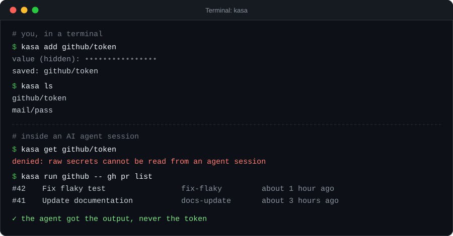
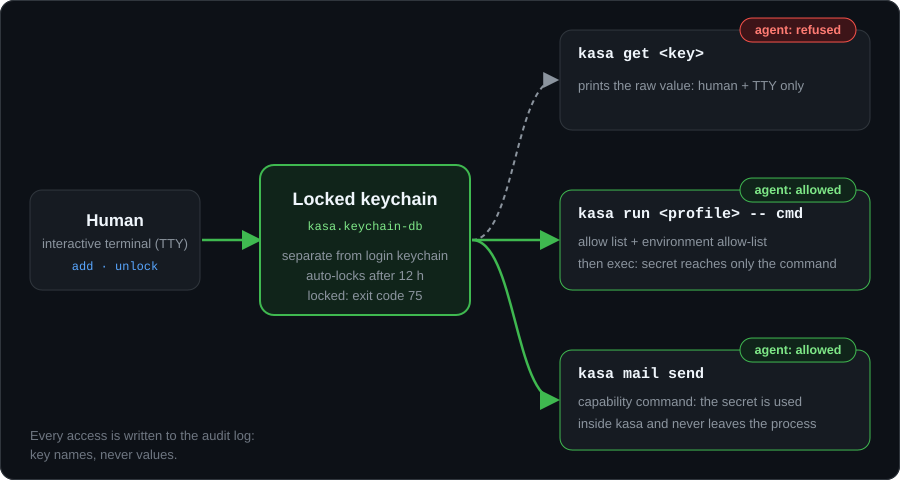

**English** · [Türkçe](README.tr.md)

<p align="center">
  
</p>

<p align="center">
  <b>kasa keeps your secrets in a separate, lockable macOS keychain and lets AI coding agents run commands that use them, without the agent ever seeing the value.</b>
</p>

<p align="center">
  
  
  
  
</p>

## Why

When you work with an AI coding agent (Claude Code, Codex, Cursor, Gemini CLI, ...), pasting a token into the chat writes it into the transcript permanently. It then lives in logs, history files and possibly provider-side storage, long after you have forgotten it.

`kasa` fixes the workflow instead of the symptom: you store a secret once, from a real terminal, and from then on the agent runs `kasa run github -- gh pr list`. The secret is injected into that one allow-listed process as an environment variable. It never appears in the conversation, in the agent's context, in a file, or in any process's arguments.

## Quick start

Requires macOS and Go (cgo enabled, which is the default).

```bash
git clone https://github.com/eirikaleid/kasa.git
cd kasa
make install                 # builds, ad-hoc signs, installs to ~/.local/bin/kasa

kasa init                    # once: choose a master password (only you know it)
kasa add github/token        # value is prompted, hidden, never echoed
kasa profile edit            # define which secrets go to which commands
kasa run github -- gh pr list
```

Make sure `~/.local/bin` is on your `PATH`. A minimal `~/.config/kasa/profiles.json` for the example above:

```json
{
  "profiles": {
    "github": {
      "aciklama": "GitHub CLI",
      "secrets": { "GITHUB_TOKEN": "github/token" },
      "allow": ["gh"]
    }
  }
}
```

<p align="center">
  
</p>

## How it works

<p align="center">
  
</p>

Secrets live in a dedicated keychain (`~/Library/Keychains/kasa.keychain-db`), not in your login keychain. It auto-locks after 12 hours of inactivity; while it is locked nobody can read anything. Agents can use secrets in two ways, and neither reveals the value:

1. **`kasa run <profile> -- <cmd>`** resolves `<cmd>` to a full path, checks it against the profile's `allow` list, builds a minimal environment (see [Profiles](#profiles)) and `exec`s the command with the secrets added. Free-form commands are refused.
2. **Capability commands** such as `kasa mail send` use the secret inside the `kasa` process and never hand it out.

`kasa get`, `kasa rm`, `kasa unlock` and `kasa import` are for humans: they refuse to run inside a detected agent environment or without a TTY. Every access is written to `~/.local/state/kasa/audit.log` (key names, never values).

If the keychain is locked, `kasa` exits with status `75` (`EX_TEMPFAIL`) instead of popping up a dialog, so agents and scheduled jobs fail cleanly. A human in a terminal gets the macOS password dialog; `KASA_SOR=1` opts in explicitly.

## AI agent integration

The agent-side guard is a best-effort speed bump. The real boundaries are the separate locked keychain and **your agent's own permission rules**. Configure both.

**Claude Code** (`~/.claude/settings.json` or project `.claude/settings.json`):

```json
{
  "permissions": {
    "allow": [
      "Bash(kasa run:*)",
      "Bash(kasa ls)",
      "Bash(kasa status)"
    ],
    "deny": [
      "Bash(kasa get:*)",
      "Bash(kasa rm:*)",
      "Bash(kasa unlock:*)",
      "Bash(kasa import:*)",
      "Bash(security find-generic-password:*)"
    ]
  }
}
```

**Codex, Cursor, Gemini CLI and others:** put the rules from [`AGENTS.md`](AGENTS.md) in the agent's instruction file and use the tool's own command allow/deny mechanism for the same patterns.

Ready-made files:

- [`AGENTS.md`](AGENTS.md): short rule set for agents that use kasa.
- [`skills/kasa/SKILL.md`](skills/kasa/SKILL.md): a Claude Code skill (copy it to `~/.claude/skills/kasa/`).
- [`llms.txt`](llms.txt): machine-readable project summary.
- [`docs/agents.md`](docs/agents.md): detailed setup for Claude Code, Codex and Cursor.

The one rule for agents: never ask the user to paste a secret, never call `kasa get`, use `kasa run`. If `kasa` exits with `75`, it is locked: ask the human to run `kasa unlock`.

## Commands

| Command | Description | Who |
|---|---|---|
| `kasa init` | Create the keychain (once) | human |
| `kasa unlock` / `kasa lock` / `kasa status` | Unlock, lock, show state and caller | unlock: human |
| `kasa unlock --gui` | Unlock through the macOS password dialog | human |
| `kasa morning` | Ask for the password via dialog if not unlocked today (for [launchd](contrib/launchd/README.md)) | scheduler |
| `kasa add <ns/key>` | Add a secret (hidden prompt) | human |
| `kasa add <ns/key> --stdin` | Read the value from stdin (for pipes) | human |
| `kasa ls` | List key names (no values) | anyone |
| `kasa get <ns/key>` | Print the raw value | human + TTY only |
| `kasa rm <ns/key>` | Delete a secret | human + TTY only |
| `kasa run <profile> -- <cmd> [args]` | Run an allow-listed command with the profile's secrets as env vars | anyone |
| `kasa mail send --profile <p> --to <addr> --subject <s> [--body <m> \| --body-file <f>]` | Send mail via the profile's SMTP settings | anyone |
| `kasa profile ls \| edit \| path` | Show, edit or locate the profile file | anyone |
| `kasa audit [-n 30]` | Show the access log | anyone |
| `kasa target add\|rm\|ls [dir]` | Manage backup targets | human |
| `kasa export` | Write an encrypted backup to every target | needs backup password |
| `kasa export --target <dir>` | One-off target (see agent note under [Backups](#backups)) | needs backup password |
| `kasa backup ls` | Show backups per target and how old they are | anyone |
| `kasa backup-password status\|set\|rm` | Manage the stored backup password | set/rm: human |
| `kasa import <file.age> [--overwrite]` | Restore a backup on this machine | human + TTY only |
| `kasa version` | Print the version | anyone |

Keys have the form `<namespace>/<name>`, for example `github/token` or `mail/pass`. The Turkish command names (`hedef`, `yedek`, `yedek-parola`, `sabah`, `--pencere`) work as well.

## Profiles

A profile maps environment variable names to key names and lists the commands allowed to receive them. Profiles hold references, never secrets. User profiles live in `~/.config/kasa/profiles.json`:

```json
{
  "profiles": {
    "github": {
      "aciklama": "GitHub CLI",
      "secrets": { "GITHUB_TOKEN": "github/token" },
      "allow": ["gh", "git"]
    },
    "mail": {
      "secrets": { "SMTP_USER": "mail/user", "SMTP_PASS": "mail/pass" },
      "allow": [],
      "smtp": { "host": "smtp.example.com", "port": 587, "from": "me@example.com" }
    }
  }
}
```

`aciklama` is an optional description. `smtp` is only needed for `kasa mail send`, which expects the secrets `SMTP_USER` and `SMTP_PASS`.

**Allow list.** The command is resolved to an absolute path and that path is what gets executed.

- A bare name (`"gh"`) matches only when the binary sits in a trusted directory (system directories, `/opt/homebrew`, `~/.local/bin`, pipx venvs, plus anything you bake in with [`TRUSTED_DIRS` / `DEV_ROOT`](#build-options)) and, for symlinks, the target is trusted too.
- An absolute entry (`"/usr/local/bin/deploy"`, `"~/bin/deploy"`) must match the resolved path exactly.

**Environment.** The child process never inherits your full environment. It gets a fixed `PATH`, the profile's secrets, and an allow-list of variables (default: `HOME USER LOGNAME SHELL TMPDIR TERM COLORTERM NO_COLOR TZ LANG LC_* SSH_AUTH_SOCK`). Override it per profile with `"ortam": ["LANG", "LC_*", "MY_VAR"]`; `"ortam": []` means only `PATH` and secrets. Injection variables (`DYLD_*`, `LD_*`, `BASH_ENV`, `GIT_*`, `NODE_*`, `PYTHON*`, proxy and CA variables, ...) are always dropped, and the drop is logged as a `NOTE` with the variable name only.

**Locked profiles.** The user profile file is writable by you, and therefore by an agent running as you. For high-value secrets, put the profile in the root-owned `/usr/local/etc/kasa/profiles.json`. The file and all its parent directories must be root-owned and not group/world-writable, otherwise kasa refuses to run. Locked profiles override user profiles of the same name, can only be changed with `sudo`, should list absolute paths in `allow`, and their keys cannot be used by any other profile.

> Unlocked profiles are a convenience, not a security boundary. An agent that can edit `profiles.json` can, for example, point the `smtp` host at another server and have `kasa mail send` deliver the password there. Use locked profiles for anything valuable.

## Backups

The keychain file is macOS-specific and is never copied anywhere. The portable format is the file written by `kasa export`: an [age](https://age-encryption.org) file, passphrase-encrypted (scrypt) with ASCII armor. It contains the secrets and the profiles.

```bash
kasa target add /Volumes/Backup/kasa      # a target is just a directory
kasa target add ~/private-repo/backups
kasa target ls

kasa unlock
kasa export                               # same encrypted blob to every target
kasa backup ls                            # what is where, how old (stale after 30 days)
```

A target can be an external disk, a NAS mount, a cloud-sync folder or a directory in a private git repository. `export` encrypts once, verifies its own output by decrypting it, writes the same blob to each target atomically, reads each file back and compares it byte for byte. If any target fails, the command exits non-zero.

**Backup password.** `kasa backup-password set` stores the password in the kasa keychain under a separate service, so unattended exports work (for example from [launchd](contrib/launchd/README.md)). New passwords must be at least 12 characters and use all four character classes (upper, lower, digit, punctuation). Setting and removing the password is human-only, so an agent cannot plant a password it knows. Enter the password that opens your existing backups; changing it only affects new files.

**Agent note.** In an agent environment `export` writes only to configured targets (`kasa target add`), not to arbitrary paths, and works only if the backup password is already stored.

**Restore** on a new machine, in this order:

```bash
kasa init
kasa unlock
kasa import kasa-backup-YYYYMMDD.age        # prompts for the backup password
```

`import` never overwrites existing keys unless you pass `--overwrite`. It is human + TTY only.

**Without kasa.** Any machine with `age` can open a backup. This is your insurance:

```bash
age -d kasa-backup-YYYYMMDD.age > contents.json
```

Keep at least two targets, and keep one of them off the machine. If a backup lives in a git repository, the repository must be private and the password long: anyone with the file can try to crack it offline.

## Security model

In short: secrets sit in a separate, auto-locking keychain; raw reads are human-only; agents get values only through an allow-listed `kasa run` or a capability command; secrets and passwords are never placed in the arguments of any child process (writes go through Security.framework; reads come back over a pipe); `run` uses a fixed `PATH` and an environment allow-list; high-value secrets can use root-owned locked profiles; every access is audited.

The human/agent guard (agent marker variables plus a TTY check) is **best effort**. An agent running as the same user, whether well-behaved or prompt-injected, can defeat it. The actual boundaries are the separate locked keychain, your agent's permission rules, and root-owned locked profiles.

The full threat model, what kasa does and does not protect against, and the known residual risks are in [SECURITY.md](SECURITY.md).

## Build options

```bash
make install BINDIR=~/bin
make install TRUSTED_DIRS="~/bin:/opt/tools/bin" DEV_ROOT="~/src"
```

| Variable | Meaning |
|---|---|
| `BINDIR` | Install directory (default `~/.local/bin`) |
| `TRUSTED_DIRS` | Colon-separated extra directories a bare allow entry may resolve into; also added to the child `PATH` |
| `DEV_ROOT` | Project root; `<root>/**/.venv/bin` and `venv/bin` become trusted, and symlinks may point below it |

These are baked into the binary at build time on purpose. A runtime config file would be writable by the very agents kasa guards against, which could add their own directory and bypass the allow check. The build also signs the binary with the hardened runtime so that `dyld` ignores `DYLD_*` variables for `kasa` itself, and it needs cgo (the home directory is read from the account database, not from `$HOME`).

Other targets: `make build`, `make test`, `make vet`, `make clean`.

## Known limitations

- macOS only. kasa builds on the Security framework and the `security` keychain tooling.
- CLI messages are currently Turkish; English output is planned.
- The agent guard is best effort, not a security boundary (see [SECURITY.md](SECURITY.md)).
- Unlocked profiles are a convenience; use locked profiles for high-value secrets.

## License

[MIT](LICENSE)
