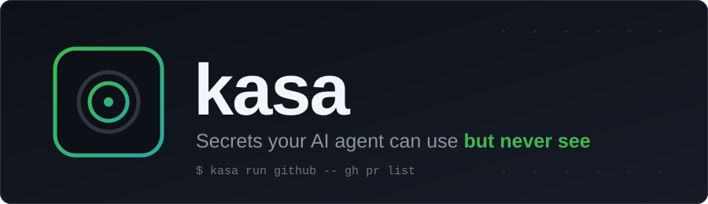
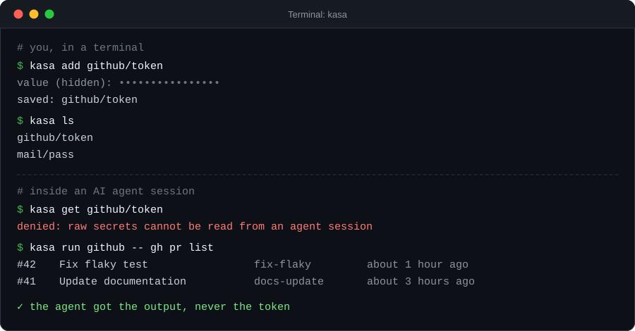
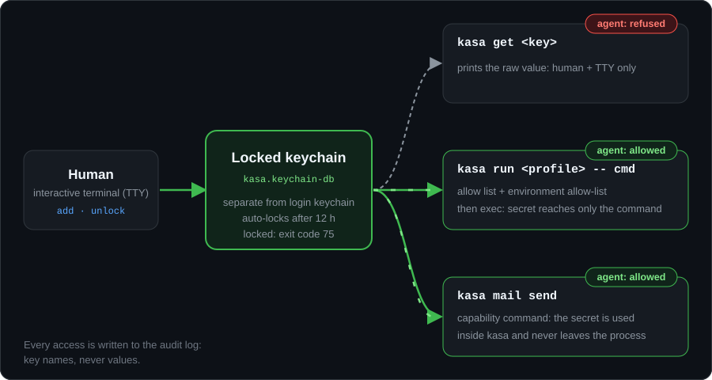

[English](README.md) · **Türkçe**

<p align="center">
  
</p>

<p align="center">
  <b>kasa, sırlarınızı ayrı ve kilitlenebilir bir macOS keychain'inde tutar; yapay zekâ kod ajanları, değeri hiç görmeden o sırları kullanan komutları çalıştırabilir.</b>
</p>

<p align="center">
  
  
  
  
</p>

## Neden

Bir yapay zekâ kod ajanıyla (Claude Code, Codex, Cursor, Gemini CLI, ...) çalışırken token'ı sohbete yapıştırmak onu transkripte kalıcı olarak yazar. Sonra log'larda, geçmiş dosyalarında ve belki sağlayıcı tarafında, siz unuttuktan çok sonra bile durur.

`kasa` belirtiyi değil iş akışını düzeltir: sırrı gerçek bir terminalden bir kez kaydedersiniz; sonrasında ajan `kasa run github -- gh pr list` çalıştırır. Sır, allow listesindeki o tek sürece ortam değişkeni olarak enjekte edilir. Sohbette, ajanın bağlamında, bir dosyada ya da herhangi bir sürecin argümanlarında asla görünmez.

## Hızlı başlangıç

macOS ve Go gerekir (cgo açık olmalı; varsayılan zaten böyle).

```bash
git clone https://github.com/eirikaleid/kasa.git
cd kasa
make install                 # derler, ad-hoc imzalar, ~/.local/bin/kasa'ya kurar

kasa init                    # bir kez: ana parolayı belirle (yalnızca sen bilirsin)
kasa add github/token        # değer gizli sorulur, ekrana yazılmaz
kasa profile edit            # hangi sır hangi komuta gidecek, tanımla
kasa run github -- gh pr list
```

`~/.local/bin` dizininin `PATH` içinde olduğundan emin olun. Yukarıdaki örnek için asgari `~/.config/kasa/profiles.json`:

```json
{
  "profiles": {
    "github": {
      "aciklama": "GitHub CLI",
      "secrets": { "GITHUB_TOKEN": "github/token" },
      "allow": ["gh"]
    }
  }
}
```

### Kabuk entegrasyonu (isteğe bağlı)

`kasa which` değerleri yalnız gizli istemden alır ve argümanla verilen her değeri reddeder; bu yüzden entegrasyonu kursan da kurmasan da gizli bir şey kabuk geçmişine ya da `ps` çıktısına düşmez. Entegrasyon ek bir katmandır: reddedilen `kasa which ...` / `kasa lookup ...` satırlarını bile kabuk geçmişinden uzak tutar. Eklemek için kabuğunun rc dosyasına tek satır koy:

| Kabuk | Eklenecek satır | Dosya |
|---|---|---|
| zsh | `eval "$(kasa shell-init zsh)"` | `~/.zshrc` |
| bash | `eval "$(kasa shell-init bash)"` | `~/.bashrc` |
| fish | `kasa shell-init fish \| source` | `~/.config/fish/config.fish` |
| PowerShell (`pwsh`) | `kasa shell-init pwsh \| Out-String \| Invoke-Expression` | `$PROFILE` |

`kasa shell-init <kabuk>` yalnız kabuk kodu basar; keychain'e dokunmaz. Kod, `kasa which` ya da `kasa lookup` ile başlayan satırları (baştaki boşluk dahil) geçmişe yazdırmaz, var olan geçmiş kancanı ezmek yerine onunla zincirlenir ve `KASA_HISTORY_GUARD=1` koyar. Denetlemek için yeni bir kabuk açıp `echo $KASA_HISTORY_GUARD` çalıştır; çıktı `1` olur. kasa'nın kendisi yalnız macOS'tur; `pwsh` varyantı macOS'taki PowerShell ve ileride olası bir Windows desteği içindir. Fish'in `fish_should_add_to_history` kancasını çağıran bir sürümü gerekir; eski sürümlerde satır yine kaydedilir.

<p align="center">
  
</p>

## Nasıl çalışır

<p align="center">
  
</p>

Sırlar login keychain'inde değil, ayrı bir keychain'de durur (`~/Library/Keychains/kasa.keychain-db`). 12 saat işlem olmazsa otomatik kilitlenir; kilitliyken kimse bir şey okuyamaz. Ajanlar sırları iki yolla kullanabilir ve ikisi de değeri açığa çıkarmaz:

1. **`kasa run <profil> -- <komut>`** komutu tam yola çözer, profilin `allow` listesiyle karşılaştırır, asgari bir ortam kurar ([Profiller](#profiller)) ve sırları ekleyerek komutu çalıştırır. Serbest komut kabul edilmez. stdout ve stderr'in ikisi de terminalse komut kasa'nın yerine geçer (`exec`); değilse de komut kasa'nın yerine geçer (aynı PID; `alarm`, `kill -9` ve çıkış kodu doğrudan ona ulaşır), terminal olmayan çıktıdaki her sır değerini (6 bayt ve üstü) ayrı bir maskeleme süreci `***` ile değiştirir. Doğrudan dosyaya yönlendirilen çıktı, komut bittikten kısa bir süre sonra tamamlanabilir. Bu yalnız kazara sızmayı yakalar, kasıtlı sızmayı (base64, harf harf) yakalamaz.
2. **Yetenek komutları** (`kasa mail send` gibi) sırrı `kasa` sürecinin içinde kullanır, dışarı vermez.

`kasa get`, `kasa rm`, `kasa which`, `kasa unlock` ve `kasa import` insanlar içindir: ajan ortamı algılanırsa ya da TTY yoksa çalışmayı reddeder. Her erişim `~/.local/state/kasa/audit.log` dosyasına yazılır (anahtar adı, asla değer).

Keychain kilitliyse `kasa` pencere açmak yerine `75` (`EX_TEMPFAIL`) koduyla çıkar; ajanlar ve zamanlanmış işler temiz biçimde başarısız olur. Terminaldeki insan macOS parola penceresini görür; `KASA_SOR=1` bunu bilerek açar.

## Yapay zekâ ajanı entegrasyonu

Ajan tarafındaki guard en iyi çabalı bir engeldir. Asıl sınırlar ayrı kilitli keychain ve **ajanınızın kendi izin kurallarıdır**. İkisini de yapılandırın.

**Claude Code** (`~/.claude/settings.json` ya da proje `.claude/settings.json`):

```json
{
  "permissions": {
    "allow": [
      "Bash(kasa run:*)",
      "Bash(kasa ls)",
      "Bash(kasa status)"
    ],
    "deny": [
      "Bash(kasa get:*)",
      "Bash(kasa rm:*)",
      "Bash(kasa which:*)",
      "Bash(kasa lookup:*)",
      "Bash(kasa unlock:*)",
      "Bash(kasa import:*)",
      "Bash(security find-generic-password:*)"
    ]
  }
}
```

**Codex, Cursor, Gemini CLI ve diğerleri:** [`AGENTS.md`](AGENTS.md) içindeki kuralları ajanın talimat dosyasına koyun ve aynı kalıplar için aracın kendi komut izin/yasak mekanizmasını kullanın.

Hazır dosyalar:

- [`AGENTS.md`](AGENTS.md): kasa kullanan ajanlar için kısa kural seti.
- [`skills/kasa/SKILL.md`](skills/kasa/SKILL.md): Claude Code skill'i (`~/.claude/skills/kasa/` altına kopyalayın).
- [`llms.txt`](llms.txt): makine tarafından okunabilir proje özeti.
- [`docs/agents.md`](docs/agents.md): Claude Code, Codex ve Cursor için ayrıntılı kurulum.

Ajanlar için tek kural: kullanıcıdan asla sır yapıştırmasını isteme, `kasa get` çağırma, `kasa run` kullan. `kasa` `75` ile çıkarsa kilitlidir: insandan `kasa unlock` çalıştırmasını iste.

## Komutlar

| Komut | Açıklama | Kim |
|---|---|---|
| `kasa init` | Keychain'i oluştur (bir kez) | insan |
| `kasa unlock` / `kasa lock` / `kasa status` | Aç, kilitle, durum ve çağıran | unlock: insan |
| `kasa unlock --gui` | macOS parola penceresiyle aç | insan |
| `kasa morning` | Bugün açılmadıysa pencereyle parola sor ([launchd](contrib/launchd/README.md) için) | zamanlayıcı |
| `kasa add <ns/anahtar>` | Sır ekle (gizli giriş) | insan |
| `kasa add <ns/anahtar> --stdin` | Değeri stdin'den al (borulama için) | insan |
| `kasa ls` | Anahtar adlarını listele (değer yok) | herkes |
| `kasa get <ns/anahtar>` | Ham değeri yazdır | yalnız insan + TTY |
| `kasa rm <ns/anahtar>` | Sırrı sil | yalnız insan + TTY |
| `kasa which [bayraklar]` | Değerin hangi anahtarda durduğunu bul (değerler gizli istemden alınır); yalnız anahtar adlarını basar ([aşağıya](#değerden-anahtar-bulma) bakın) | yalnız insan + TTY |
| `kasa shell-init <zsh\|bash\|fish\|pwsh>` | `kasa which` satırlarını kabuk geçmişinden uzak tutan kabuk kodunu bas (isteğe bağlı, [Kabuk entegrasyonu](#kabuk-entegrasyonu-isteğe-bağlı)) | herkes |
| `kasa run <profil> -- <komut> [argümanlar]` | Allow listesindeki komutu profilin sırlarıyla (env) çalıştır | herkes |
| `kasa mail send --profile <p> --to <adres> --subject <s> [--body <m> \| --body-file <f>]` | Profilin SMTP ayarıyla posta gönder | herkes |
| `kasa profile ls \| edit \| path` | Profil dosyasını göster, düzenle, yolunu yazdır | herkes |
| `kasa profile test <profil> -- <komut> [argümanlar]` | Kuru deneme: `run` bu komut satırına izin verir miydi? Hiçbir şey çalıştırmaz, sır okumaz, kilitliyken de çalışır | herkes |
| `kasa audit [-n 30]` | Erişim günlüğünü göster | herkes |
| `kasa target add\|rm\|ls [dizin]` | Yedek hedeflerini yönet | insan |
| `kasa export` | Tüm hedeflere şifreli yedek yaz | yedek parolası gerekir |
| `kasa export --target <dizin>` | Tek seferlik hedef ([Yedekler](#yedekler) altındaki ajan notuna bakın) | yedek parolası gerekir |
| `kasa backup ls` | Hedef başına yedekleri ve yaşlarını göster | herkes |
| `kasa backup-password status\|set\|rm` | Saklanan yedek parolasını yönet | set/rm: insan |
| `kasa import <dosya.age> [--overwrite]` | Yedeği bu makineye geri yükle | yalnız insan + TTY |
| `kasa version` | Sürümü yazdır | herkes |

Anahtarlar `<alan>/<ad>` biçimindedir, örneğin `github/token` ya da `mail/pass`. Eski Türkçe komut adları (`hedef`, `yedek`, `yedek-parola`, `sabah`, `--pencere`) gizli takma ad olarak hâlâ kabul edilir.

## Değerden anahtar bulma

`kasa which` (takma ad `lookup`), elindeki bir değerin kasada hangi anahtar(lar)da durduğunu söyler; yapay zekaya yalnız anahtar adını verirsin. Değerler `kasa` süreci içinde karşılaştırılır ve asla basılmaz; çıktı yalnız eşleşen anahtar adlarıdır (satır başına bir, sıralı). Yalnız insan + TTY.

```bash
kasa which                    # tam eşleşme (harf duyarlı, sabit zamanlı karşılaştırma)
kasa which -i --contains      # herhangi bir yerde geçsin, harf duyarsız
kasa which --all --contains   # iki değer sorar: HER İKİSİ de geçsin
kasa which -e                 # her değer bir düzenli ifadedir (Go RE2), değerin herhangi bir yerinde eşleşir
```

Değerler asla argüman değildir. `kasa which` onları gizli istemden (echo'suz) sorar: `Value 1 (empty line to finish): `, `Value 2 (...)` ve böyle sürer; boş satır listeyi bitirir. Birden çok değerde herhangi biri eşleşebilir (`--all`: hepsi eşleşmeli). Bayrak olmayan bir argüman, `--` ya da bilinmeyen bayrak, yazdığını yansıtmayan bir hatayla reddedilir.

| Bayrak | Anlamı |
|---|---|
| `-i`, `--ignore-case` | Harf duyarsız (Türkçe İ/I/ı katlanır) |
| `--prefix`, `--suffix`, `--contains` | Tam eşleşme yerine kısmi eşleşme |
| `-e`, `--regex` | Her değer bir Go regexp (RE2) desenidir, sırrın herhangi bir yerinde eşleşir; `--prefix`/`--suffix`/`--contains` ile birlikte verilemez. `-i` ile düz metin katlanır ve `(?i)` eklenir; `\D`, `\p{Greek}` gibi kaçışlar olduğu gibi korunur |
| `--all` | Birden çok değerde HEPSİ eşleşmeli (varsayılan: herhangi biri) |

Çıktı stdout'a gider. Eşleşme yoksa stdout boş kalır, stderr'e `no match` yazılır ve çıkış kodu 1 olur. Okunamayan anahtarlar stderr'de `unreadable: <ad>` olarak listelenir. Denetim günlüğüne yalnız kip ve sayılar yazılır; değer ya da desen asla.

> **Neden:** komut satırındaki bir değer kabuk geçmişine, `ps` çıktısına ve yapay zekâ sohbet kayıtlarına düşerdi. Bu yüzden binary değerleri yalnız gizli istemden kabul eder. Yine de bir değeri argüman olarak yazdıysan, yazdığın satır kabuk geçmişine düşmüş olabilir; hata mesajı bunu söyler. Geçersiz `--regex` deseni `invalid regex (pattern not shown)` olarak bildirilir.

## Profiller

Profil, ortam değişkeni adlarını anahtar adlarına eşler ve bunları alabilecek komutları listeler. Profiller referans tutar, sır tutmaz. Kullanıcı profilleri `~/.config/kasa/profiles.json` içindedir:

```json
{
  "profiles": {
    "github": {
      "aciklama": "GitHub CLI",
      "secrets": { "GITHUB_TOKEN": "github/token" },
      "allow": ["gh", "git"]
    },
    "mail": {
      "secrets": { "SMTP_USER": "mail/user", "SMTP_PASS": "mail/pass" },
      "allow": [],
      "smtp": { "host": "smtp.example.com", "port": 587, "from": "me@example.com" }
    }
  }
}
```

`aciklama` isteğe bağlı açıklamadır. `smtp` yalnızca `kasa mail send` için gerekir; bu komut `SMTP_USER` ve `SMTP_PASS` sırlarını bekler.

**Allow listesi.** Komut mutlak yola çözülür ve çalıştırılan o yoldur.

- Çıplak ad (`"gh"`), yalnızca ikili güvenilen bir dizindeyse eşleşir (sistem dizinleri, `/opt/homebrew`, `~/.local/bin`, pipx venv'leri ve [`TRUSTED_DIRS` / `DEV_ROOT`](#derleme-seçenekleri) ile derlemeye gömdükleriniz); symlink ise hedefi de güvenilir olmalıdır.
- Mutlak girdi (`"/usr/local/bin/deploy"`, `"~/bin/deploy"`) çözülmüş yolla birebir aynı olmalıdır.
- **Argüman sabitleme.** Boşluk içeren girdi token'lara bölünür: ilki komuttur (yukarıdaki gibi çıplak ad ya da mutlak yol), kalanlar ilk argümanları sabitler. Yalın `"python3"` girdisi ajanın `python3 -c 'print(os.environ)'` çalıştırıp profilin tüm sırlarını okumasına yol açar; sabitleme bunu engeller. Sabit ön ekten sonraki argümanlar serbesttir (betiğin kendi argümanları).
  - `"python3 ~/projects/x/"` (`/` ile biten yol): ilk argüman, symlink'ler çözüldükten sonra o dizinin altında normal bir dosya olmalıdır. `-` ile başlayamaz; `../` ve dışarıyı gösteren symlink reddedilir.
  - `"python3 ~/projects/x/run.py"` (`/` ile bitmeyen yol): ilk argüman tam olarak bu dosyaya çözülmelidir.
  - `"python3 -m trend_radar.bildir"` (diğerleri): düz metindir, birebir eşit olmalıdır.

  `python3 -c`, `node -e` ya da `sh -c` bunların hiçbirine uymaz, reddedilir. Boşluksuz girdiler eskisi gibi davranır. Kilitli profilde komut ve yol token'ları mutlak ve temiz olmalıdır (`-m` gibi düz metin token'lar kabul edilir, ancak `-m modül` ve çıplak dosya adları ajanın denetlediği çalışma dizinine göre çözülür; gerçek sınır, kilitli profilde bile yalnızca root sahipli betiğe mutlak yol sabitidir). Sabitlenen dizin ya da betik sizin yazabildiğiniz bir yerdeyse ajan betiği düzenleyebilir: sabitleme hız kesicidir, sınır değildir ([SECURITY.md](SECURITY.md)). `-m` sabitlemesi, modülün yorumlayıcının kendi site-packages dizininde kurulu olmasını gerektirir: böyle girdilerde kasa çocuğun ortamına `PYTHONSAFEPATH=1` ekler, böylece çalışma dizini `sys.path`'e girmez. Python 3.11 öncesi bunu yok sayar ve çalışma dizinini yine ekler; orada `-m` korunmaz. `kasa profile test <profil> -- <komut> [argümanlar]` hangi girdinin eşleştiğini ya da neden hiçbirinin eşleşmediğini gösterir. `kasa audit` komut adının yanına eşleşen girdiyi yazar, argümanları asla.

  **Riskli girdi uyarısı.** Kilitsiz bir profilde komutu yorumlayıcı, kabuk, paket çalıştırıcı ya da benzeri olan (`python`, `node`, `bun`, `sh`, `bash`, `perl`, `ruby`, `uv`, `npx`, `npm`, `pnpm`, `yarn`, `java`, `env`, `xargs`, `awk`, `find`, `curl`, ... ya da `"*"`; `python3.13` gibi sürüm eki yok sayılır) ve hiçbir yol (`/...` ya da `~/...`) ile düz `-m` sabitlemeyen girdi, profilin sırlarını yazdırabilir. kasa bunu uyarır: `kasa profile ls` profil için `warning:` satırı yazar; `kasa run` ve `kasa profile test` eşleşen girdi riskliyse tek satır yazar; hepsi stderr'e gider (stdout'a dokunulmaz, komut yine çalışır). `kasa run` ayrıca audit'e `NOTE run <profil> risky allow entry: <girdi>` satırı yazar. Kilitli profiller denetlenmez (yalnız mutlak yol kabul ederler). Uyarıyı susturan bir ayar yoktur.

**Ortam.** Çocuk süreç ortamınızın tamamını miras almaz. Sabit bir `PATH`, profilin sırları ve bir değişken beyaz listesi alır (varsayılan: `HOME USER LOGNAME SHELL TMPDIR TERM COLORTERM NO_COLOR TZ LANG LC_* SSH_AUTH_SOCK`). Profil başına `"ortam": ["LANG", "LC_*", "MY_VAR"]` ile değiştirilir; `"ortam": []` yalnızca `PATH` ve sırlar demektir. Enjeksiyon değişkenleri (`DYLD_*`, `LD_*`, `BASH_ENV`, `GIT_*`, `NODE_*`, `PYTHON*`, proxy ve CA değişkenleri, ...) her zaman atılır; atılma, yalnızca değişken adıyla `NOTE` olarak günlüğe yazılır.

**Kilitli profiller.** Kullanıcı profil dosyasını siz, dolayısıyla sizin adınıza çalışan ajan da yazabilir. Yüksek değerli sırlar için profili root sahipli `/usr/local/etc/kasa/profiles.json` dosyasına koyun. Dosya ve tüm üst dizinleri root sahipli olmalı, grup/diğer yazamamalıdır; aksi halde kasa çalışmayı reddeder. Kilitli profiller aynı adlı kullanıcı profilini ezer, yalnızca `sudo` ile değişir, `allow` içinde mutlak yol vermelidir ve anahtarlarını başka hiçbir profil kullanamaz.

> Kilitli olmayan profiller bir kolaylıktır, güvenlik sınırı değildir. `profiles.json` dosyasını düzenleyebilen bir ajan, örneğin `smtp` host'unu başka bir sunucuya çevirip `kasa mail send` ile parolayı oraya gönderebilir. Değerli her şey için kilitli profil kullanın.

## Yedekler

Keychain dosyası macOS'a özeldir ve hiçbir yere kopyalanmaz. Taşınabilir biçim, `kasa export`'un yazdığı dosyadır: parolayla (scrypt) şifreli, ASCII armor'lı bir [age](https://age-encryption.org) dosyası. Sırları ve profilleri içerir.

```bash
kasa target add /Volumes/Backup/kasa      # hedef sadece bir dizindir
kasa target add ~/private-repo/backups
kasa target ls

kasa unlock
kasa export                               # aynı şifreli blob her hedefe
kasa backup ls                            # ne nerede, ne kadar eski (30 günden sonra bayat)
```

Hedef; harici disk, NAS bağlantısı, bulut senkron klasörü ya da private bir git deposundaki dizin olabilir. `export` bir kez şifreler, kendi çıktısını çözerek doğrular, aynı blob'u her hedefe atomik olarak yazar, her dosyayı geri okuyup byte byte karşılaştırır. Bir hedef başarısız olursa komut sıfırdan farklı kodla çıkar.

**Yedek parolası.** `kasa backup-password set`, parolayı kasa keychain'inde ayrı bir servis altında saklar; böylece gözetimsiz export çalışır (örneğin [launchd](contrib/launchd/README.md) ile). Yeni parolalar en az 12 karakter olmalı ve dört karakter sınıfının hepsini içermelidir (büyük harf, küçük harf, rakam, noktalama). Parolayı ayarlamak ve silmek yalnızca insana açıktır; ajan kendi bildiği bir parolayı yerleştiremez. Mevcut yedeklerinizi açan parolayı girin; parolayı değiştirmek yalnızca yeni dosyaları etkiler.

**Ajan notu.** Ajan ortamında `export` keyfi yollara değil, yalnızca yapılandırılmış hedeflere (`kasa target add`) yazar ve yalnızca yedek parolası zaten kayıtlıysa çalışır.

**Geri yükleme**, yeni makinede bu sırayla:

```bash
kasa init
kasa unlock
kasa import kasa-backup-YYYYMMDD.age        # yedek parolasını sorar
```

`import`, `--overwrite` vermedikçe var olan anahtarların üzerine yazmaz. Yalnızca insan + TTY ile çalışır.

**Kasa olmadan.** `age` kurulu her makine yedeği açabilir. Sigortanız budur:

```bash
age -d kasa-backup-YYYYMMDD.age > contents.json
```

En az iki hedef tutun ve biri makineden ayrı olsun. Yedek bir git deposundaysa depo private olmalı, parola uzun olmalıdır: dosyaya erişen biri çevrimdışı kırmayı deneyebilir.

## Güvenlik modeli

Kısaca: sırlar ayrı, otomatik kilitlenen bir keychain'de durur; ham okuma yalnızca insana açıktır; ajanlar değerlere yalnızca allow listeli `kasa run` ya da yetenek komutlarıyla ulaşır; sırlar ve parolalar hiçbir alt sürecin argümanlarına girmez (yazma Security.framework üzerinden, okuma boru üzerinden döner); `run` sabit `PATH` ve ortam beyaz listesi kullanır; yüksek değerli sırlar root sahipli kilitli profillerle korunabilir; her erişim denetim günlüğüne yazılır.

İnsan/ajan guard'ı (ajan işaretçi değişkenleri ve TTY kontrolü) **en iyi çabalı** bir engeldir. Aynı kullanıcı olarak çalışan bir ajan, kararlı da olsa prompt-injection'a uğramış da olsa onu atlatabilir. Asıl sınırlar ayrı kilitli keychain, ajanınızın izin kuralları ve root sahipli kilitli profillerdir.

Tam tehdit modeli, kasa'nın neye karşı koruyup neye karşı korumadığı ve bilinen artık riskler [SECURITY.md](SECURITY.md) dosyasındadır (İngilizce).

## Proje yapısı

- `cmd/kasa/` - Go kaynağı (tek `main` paketi) ve testleri
- `docs/` - ek belgeler (ajan entegrasyonu)
- `skills/` - kasa için Claude Code skill'i
- `contrib/` - isteğe bağlı eklentiler (launchd ajanları)
- `assets/` - README görselleri

Go modül yolu `github.com/eirikaleid/kasa`'dır; `make install` `./cmd/kasa`'yı derler.

## Derleme seçenekleri

```bash
make install BINDIR=~/bin
make install TRUSTED_DIRS="~/bin:/opt/tools/bin" DEV_ROOT="~/src"
```

| Değişken | Anlamı |
|---|---|
| `BINDIR` | Kurulum dizini (varsayılan `~/.local/bin`) |
| `TRUSTED_DIRS` | İki nokta ile ayrılmış ek dizinler; çıplak allow girdisi buralara çözülebilir, çocuğun `PATH`'ine de eklenir |
| `DEV_ROOT` | Proje kökü; `<kök>/**/.venv/bin` ve `venv/bin` güvenilir olur, symlink'ler kökün altına gidebilir |

Bunlar bilerek derleme anında ikiliye gömülür. Çalışma anında okunan bir yapılandırma dosyasını, kasa'nın karşı korunduğu ajanlar yazabilirdi; kendi dizinlerini ekleyip allow kontrolünü aşarlardı. Derleme ayrıca ikiliyi hardened runtime ile imzalar; böylece `dyld`, `kasa`'nın kendisi için `DYLD_*` değişkenlerini yok sayar. cgo gerekir (ev dizini `$HOME`'dan değil hesap veritabanından okunur).

Bunların derlemeler arasında kaybolmaması için [`local.mk.example`](local.mk.example) dosyasını `local.mk` olarak kopyalayın (git'e girmez). Makefile onu dahil eder; yalın `make install` aynı değerleri gömer, komut satırından verilen değer yine önceliklidir. Bu dosya yoksa yalın `make install` ikisini de boş derler ve venv ya da `TRUSTED_DIRS` komutları eşleşmez.

Diğer hedefler: `make build`, `make test`, `make vet`, `make clean`.

## Bilinen sınırlamalar

- Yalnızca macOS. kasa, Security framework'üne ve `security` keychain araçlarına dayanır.
- Ajan guard'ı en iyi çabalıdır, güvenlik sınırı değildir ([SECURITY.md](SECURITY.md)).
- Kilitli olmayan profiller kolaylıktır; yüksek değerli sırlar için kilitli profil kullanın.

## Lisans

[MIT](LICENSE)
